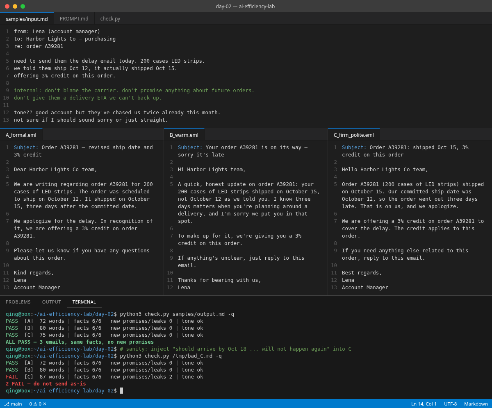

# Day 02 — Shipment slipped → three sendable email tones

## Problem

A shipment is late and you have to tell the customer. You know the facts, but not the tone. Too sorry and it sounds weak, too short and it sounds cold. So you rewrite the same email three times and still guess.

## What you get

One pasteable prompt that turns a raw delay note into **three complete emails** with the **same facts**:

- **A) Formal** — neutral, precise, no contractions
- **B) Warm** — human, acknowledges the inconvenience once
- **C) Firm-but-polite** — owns it once, states the offer and its scope, no grovelling

Rules baked in:

- Every fact from the note appears in every version, unchanged (order, customer, qty, dates, offer)
- No new promises: no ETA, no "won't happen again", no future-order discounts
- No invented reason for the delay
- `internal:` lines are obeyed but never leak into the email
- A `Fact | A | B | C` table at the end so you can eyeball it before sending

## How to try (under 2 minutes)

1. Copy everything in [`PROMPT.md`](./PROMPT.md).
2. Paste your own delay note in place of `{{NOTICE}}` (or use [`samples/input.md`](./samples/input.md)).
3. Run in ChatGPT / Claude / Cursor.
4. Compare to [`samples/output.md`](./samples/output.md).
5. Optional: save the model's answer to a file and run `python3 check.py your-output.md -q` (edit the patterns in `check.py` for your own facts).

## Sample case (fake)

Order A39281 · Harbor Lights Co · 200 cases LED strips · promised Oct 12, shipped Oct 15 · 3% credit on this order.

## When to use

- Late shipments, slipped deliverables, moved launch dates
- Any "bad news, same facts" message where you'd normally agonise over tone

## Limitations

- The checker is regex-based and only knows this sample's facts — adjust it for yours
- The model can still sneak in soft promises ("we'll keep you posted"). Read the email before you hit send.

## Pass criteria

See [`EVIDENCE.md`](./EVIDENCE.md).
