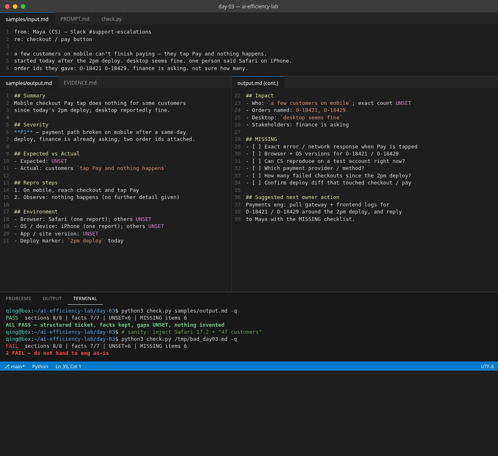

# Day 03 — Vague bug report → engineer-ready triage ticket

## Problem

Someone dumps a vague Slack or email bug report. You waste the next half hour guessing severity, inventing repro steps, and pinging CS for the same missing fields every time.

## What you get

One pasteable prompt that turns the dump into a **structured triage ticket**:

- One-line **Summary**
- **Severity** (P0–P3) with a one-line reason grounded only in stated facts
- **Expected vs Actual** (`UNSET` if missing)
- **Repro steps** — only what was stated; never invented
- **Environment** — browser / OS / version / account (`UNSET` per field)
- **Impact** / who is blocked (`UNSET` if missing)
- **MISSING** checklist — concrete questions before an engineer can start
- **Suggested next owner action** — one line

Rules baked in:

- Do not invent repro steps, versions, user counts, or root causes
- Use `UNSET` for gaps; quote key phrases from the report
- Preserve order ids / deploy markers exactly
- Stop after the ticket — no essay

## How to try (under 2 minutes)

1. Copy everything in [`PROMPT.md`](./PROMPT.md).
2. Paste your own dump in place of `{{REPORT}}` (or use [`samples/input.md`](./samples/input.md)).
3. Run in ChatGPT / Claude / Cursor.
4. Compare to [`samples/output.md`](./samples/output.md).
5. Optional: `python3 check.py samples/output.md -q` (edit patterns in `check.py` for your own facts).

## Sample case (fake)

Maya (CS) in Slack: a few customers on mobile can't finish paying — tap Pay and nothing happens. Started today after the 2pm deploy. Desktop seems fine. One person said Safari on iPhone. Order ids: O-18421, O-18429. Finance is asking. Not sure how many.

## When to use

- Slack / email / Linear dumps that are too thin for an engineer to start
- Escalations where CS has partial info and you keep asking the same questions
- Any "something is broken" note where inventing repro would waste a sprint

## Limitations

- The checker is regex-based and only knows this sample's facts — adjust it for yours
- Severity is a judgment call from stated facts; a human still owns the final P-level
- The model can still invent soft details — read the MISSING list before you assign

## Pass criteria

See [`EVIDENCE.md`](./EVIDENCE.md).
