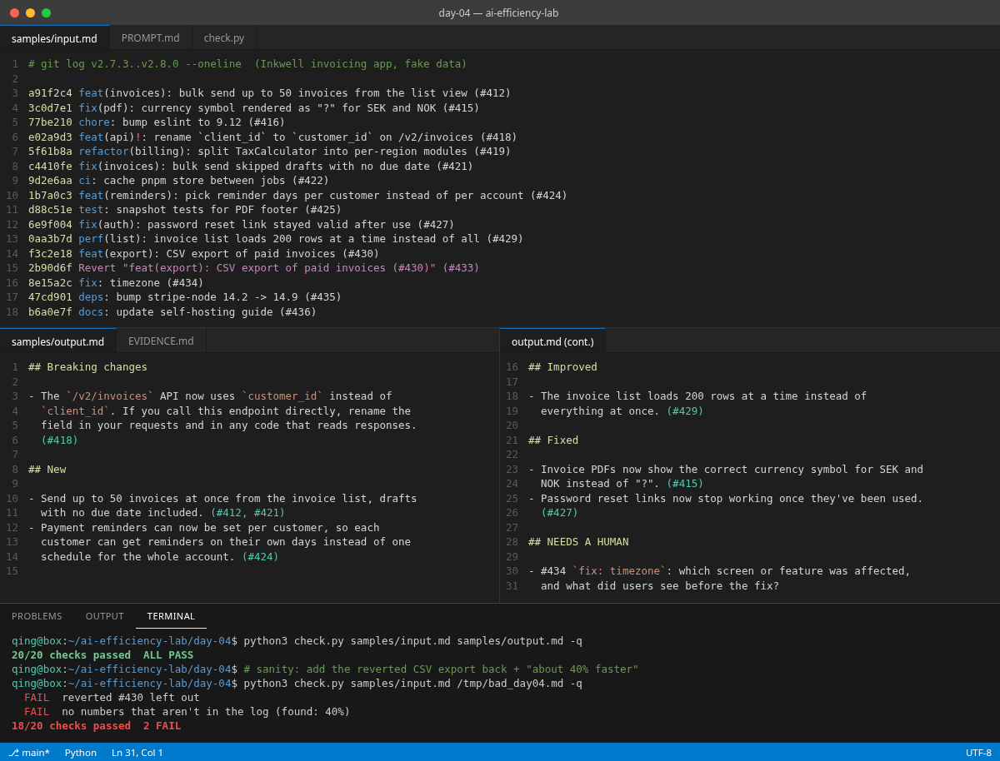

# Day 04 — Raw git log → release notes a customer can read

## Problem

Release day. You have 16 commit messages like `fix(pdf): currency symbol rendered as "?"` and `chore: bump eslint`, and somebody needs notes for customers. Pasting the log into a chat model usually gets you every commit rewritten in marketing voice, the reverted feature still announced, and a "40% faster" nobody measured.

## What you get

One pasteable prompt that turns `git log --oneline` into customer-facing notes:

- **Breaking changes** first, with what the reader has to do
- **New / Improved / Fixed** in plain words, every bullet ending in its PR number
- chore / ci / test / docs / refactor / dependency bumps left out
- Reverted commits left out together with their revert
- Fixes for features that are new in the same release folded into that feature
- **NEEDS A HUMAN** for vague messages like `fix: timezone`, with the question to ask the author

Plus `check.py`, which reads the same log and checks the notes: every customer-facing PR is there, internal and reverted ones aren't, the breaking change comes first, and no number appears that isn't in the log.

## How to try (under 2 minutes)

1. Run `git log <last-tag>..HEAD --oneline` in your repo (or copy merged PR titles).
2. Copy everything in [`PROMPT.md`](./PROMPT.md) and paste your log in place of `{{LOG}}`, or use [`samples/input.md`](./samples/input.md).
3. Run it in ChatGPT / Claude / Cursor and save the answer as `notes.md`.
4. `python3 check.py your-log.md notes.md` and read any FAIL lines.

## Sample case (fake)

Inkwell, a made-up invoicing app, going from v2.7.3 to v2.8.0: bulk send, per-customer reminders, an API field rename, a PDF currency bug, a password-reset fix, a CSV export that got reverted the same week, five internal commits, and one `fix: timezone` with no detail.

## When to use

- Weekly or per-tag release notes for a product with real customers
- Changelog pages and "what's new" emails
- Turning a sprint's merged PRs into something support can forward

## Limitations

- It only knows what the commit messages say. Bad messages in, NEEDS A HUMAN out; that's the point.
- The checker's type detection relies on conventional-commit prefixes (`feat:`, `fix:`, `chore:` and so on). Adjust `INTERNAL` and `VAGUE` in `check.py` for your repo.
- Wording is still a judgment call. Read the notes before you publish them.

## Pass criteria

See [`EVIDENCE.md`](./EVIDENCE.md).
